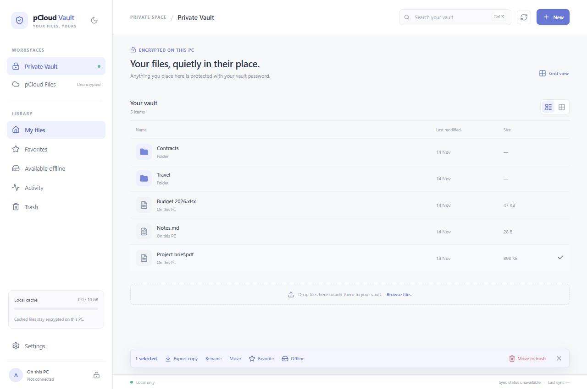
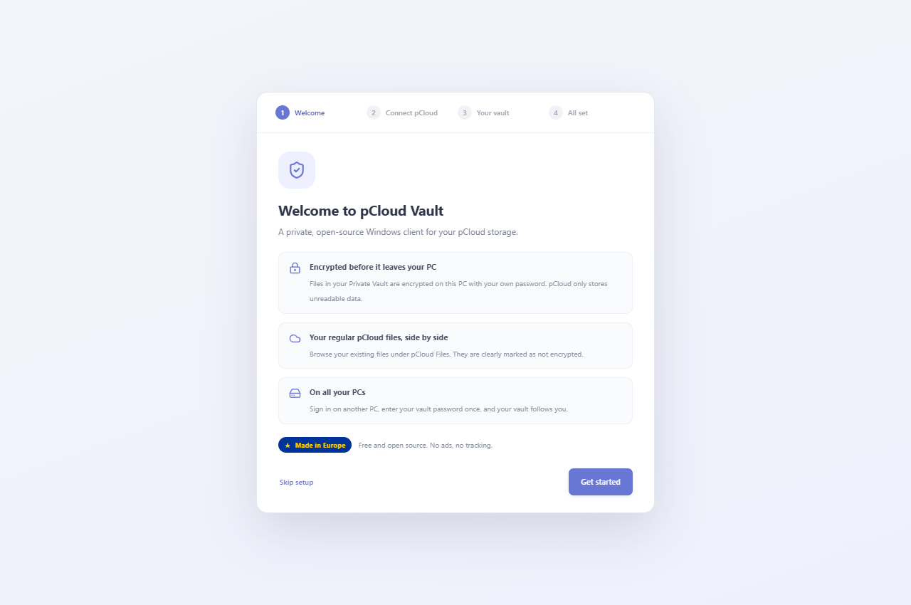
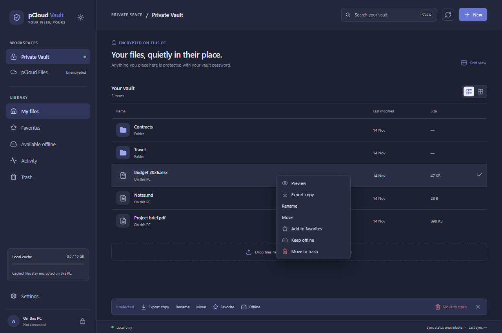

<div align="center">


# pCloud Vault

**A private, open-source Windows client for pCloud, with a client-side encrypted vault.**

[](https://github.com/wouternijenhuis/pcloud-vault/releases/latest)
[](LICENSE)




</div>

Files you put in **Private Vault** are encrypted on your PC with your own password before anything is uploaded. pCloud only stores unreadable data with random names. Your regular pCloud files stay available next to it under **pCloud Files**, clearly marked as not encrypted.

## Download

1. Download **`pCloud-Vault-<version>-windows-x64.zip`** from the [latest release](https://github.com/wouternijenhuis/pcloud-vault/releases/latest).
2. Run the installer inside, or start the portable **`pCloud Vault.exe`** directly.
3. The welcome guide helps you sign in to pCloud and create your vault password.

Requires Windows 11 x64 and a pCloud account. The app is not code-signed yet, so Windows SmartScreen may warn on first start: choose **More info → Run anyway** after checking the download against `SHA256SUMS.txt`. Every release also carries a [build provenance attestation](https://docs.github.com/actions/security-for-github-actions/using-artifact-attestations), which proves it was built from this repository:

```powershell
gh attestation verify pCloud-Vault-0.1.0-windows-x64.zip --repo wouternijenhuis/pcloud-vault
```

## Features

- **End-to-end encrypted vault.** Files, file names and folders are encrypted on your PC before upload.
- **Your existing pCloud files.** Browse, rename, move, download and trash them in the same app.
- **Sign in on pCloud's own website**, including two-step verification and Google, Apple or Facebook sign-in. Your pCloud password never passes through this app.
- **Several PCs.** Sign in on another PC, enter your vault password once, and your vault follows you. Simultaneous edits are kept as conflict copies, never silently overwritten.
- **Offline access.** Keep files offline, with an encrypted local cache (10 GiB by default).
- **Everyday comfort:** a welcome guide, drag and drop, right-click menus, search, image previews, favorites, trash and restore, light and dark themes.
- **Remembered PCs.** Unlocks with your Windows sign-in. Your password is never stored.
- **Recovery** with an offline recovery key and a stand-alone recovery tool.
- **No ads, no tracking, no analytics.** All interface assets are bundled with the app.

<p align="center">


</p>

## Getting started

Connect pCloud with **Sign in on pCloud website**, then create or unlock your vault with a password of at least 12 characters. Remembering the PC protects its unlock key with your Windows account and starts the app quietly at sign-in. Closing the window keeps transfers running in the tray; use the tray menu to open, lock or quit.

Alternatively, register your own personal-use OAuth application in pCloud's developer portal (pCloud may require manual approval) and use its public client ID with callback `http://127.0.0.1:43187/callback`. No client secret is embedded. You can also choose **Use only this PC** to keep an encrypted vault on this PC only. See [pCloud setup](docs/PCLOUD_SETUP.md).

Importing copies files and keeps the originals. Folder drag and drop is supported. Ordinary cloud files can be copied into Private Vault; restore ordinary cloud deletions through pCloud's own Trash.

Exporting creates a decrypted copy at a location you choose and never overwrites existing files. Exported copies and the originals you imported stay outside the encrypted vault. The app leaves no decrypted working files in its own cache.

## Encryption and sync

- RustCrypto Argon2id (256 MiB, three passes, one lane) protects a random 256-bit root key. XChaCha20-Poly1305 authenticates encrypted 4 MiB file chunks and metadata.
- Filenames, folders, previews managed on disk, and local preferences stay encrypted. pCloud sign-in tokens and remembered keys use current-user Windows DPAPI. Passwords are never persisted.
- Immutable encrypted commits and causal merge preserve concurrent edits as recoverable conflict copies. Uploads verify object bytes before publishing dependent commits. An encrypted local journal preserves queued work across restarts.
- Pin folders or files to keep their contents offline on this PC. The default 10 GiB cache limit is soft when pinned or pending data needs more space. Favorites and pins are per-PC preferences.
- Each new PC connects the same account and unlocks the vault with its password once. A password change rewraps the root key; it does not revoke previously trusted PCs or older password wrappers held in cloud history.

This is an initial implementation with a new vault protocol, **not an independently audited security product**. Keep independent copies of important files while validating it. Cloud providers still see object sizes and access timing; an unlocked Windows session, malware, operating-system paging, and external applications are outside the protection boundary. No automatic remote garbage collection is performed. See the exact [vault format and limitations](docs/VAULT_FORMAT.md).

## Recovery without the interface

The separate `vault-recovery.exe` verifies or exports a complete local/downloaded vault. Quit the desktop app before opening its local vault with the recovery tool, since each local replica has an exclusive process lock.

```powershell
.\vault-recovery.exe verify 'D:\EncryptedVault'
.\vault-recovery.exe export 'D:\EncryptedVault' 'D:\NewRecoveredFolder'
# Use the offline recovery key instead of the vault password:
.\vault-recovery.exe verify 'D:\EncryptedVault' --recovery
```

Secrets are prompted interactively, never supplied as command-line arguments. For automation, `--password-stdin` explicitly reads one secret line from a pipe. Do not put real secrets into shell history.

Cloud layout is `.pcloud-vault/vault.json` plus `objects/c-<id>.obj`, `m-<id>.obj`, and `h-<id>.obj`. pCloud's own website and apps hide this dot-folder, so files you add to Private Vault never appear in pCloud under their real names; see them in this app. The prefixes distinguish ciphertext chunks, manifests, and history without revealing original names. Download the whole `.pcloud-vault` directory before offline recovery, then normalize its layout:

```powershell
.\vault-recovery.exe hydrate 'D:\DownloadedCloudVault' 'D:\NewEncryptedReplica'
.\vault-recovery.exe verify 'D:\NewEncryptedReplica'
.\vault-recovery.exe export 'D:\NewEncryptedReplica' 'D:\NewPlaintextExport'
```

Hydration copies encrypted objects; verification checks their authentication before export. Missing cloud history or ciphertext cannot be recovered from a password alone.

## Building from source

Developer prerequisites are Rust stable with MSVC build tools, Node.js, and pnpm. Users of the packaged app do not need them. All UI assets are bundled, and no remote JavaScript, fonts, analytics, or application server is used.

```powershell
. .\scripts\dev-env.ps1 # optional scoped-toolchain / installed Visual Studio discovery
pnpm install --frozen-lockfile
pnpm --dir frontend install --frozen-lockfile
cargo test --workspace
cargo clippy --workspace --all-targets -- -D warnings
pnpm --dir frontend test
pnpm --dir frontend build
cargo build --release -p vault-cli
pnpm build
```

`pnpm preview` opens a clearly labeled **browser demo** using sample data; it never performs real cloud operations. `pnpm dev` starts the native Tauri app. For isolated manual QA, launch the native executable with `--data-dir <new-test-directory>`; this disables Windows startup registration for that run. Standard data is stored under the current user's application-data directory for `dev.pcloudvault.desktop`.

Pull requests to `main` run the checks in [CI](.github/workflows/ci.yml). Merging a new version (see [CONTRIBUTING.md](CONTRIBUTING.md)) publishes a release through [release.yml](.github/workflows/release.yml). There is no automatic updater.

## Contributing

Contributions are welcome. Please read [CONTRIBUTING.md](CONTRIBUTING.md) and the [code of conduct](CODE_OF_CONDUCT.md). This is a public repository: [CLAUDE.md](CLAUDE.md) (the same rules are in [AGENTS.md](AGENTS.md)) lists what must never be committed. Enable the public-safety hooks once per clone:

```powershell
git config core.hooksPath .githooks
```

Report vulnerabilities privately as described in [SECURITY.md](SECURITY.md), never in public issues.

## License

[GPL-3.0-only](LICENSE). Made in Europe.

pCloud Vault is an independent open-source project. It is not affiliated with, endorsed by or sponsored by pCloud AG. "pCloud" is a trademark of its owner and is used here only to describe compatibility.
